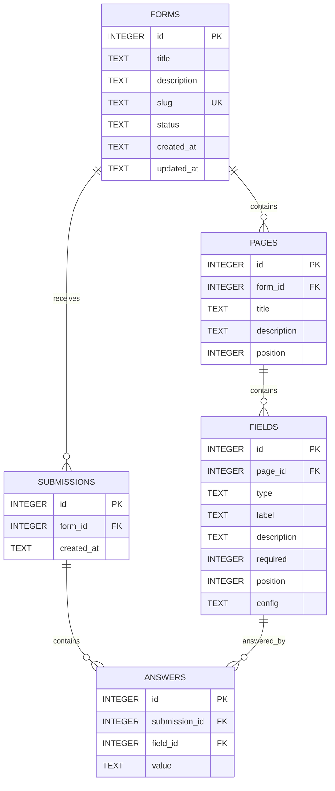

# MVP-план Form Service

## Цель

Собрать автономный сервис, в котором менеджер создаёт и публикует форму,
студент заполняет её по публичной ссылке, а менеджер просматривает полученные
ответы.

## Основной сценарий

1. Менеджер открывает `/admin`.
2. Создаёт форму.
3. Добавляет и настраивает поля.
4. Публикует форму и получает публичную ссылку.
5. Студент открывает `/forms/:slug` и отправляет ответы.
6. Менеджер просматривает отправку и ответы.
7. Данные остаются в SQLite после перезапуска приложения.

## Правила разработки

- Выполнять этапы по порядку.
- Сначала завершить основной сценарий, затем улучшать внешний вид.
- Не добавлять слой или библиотеку без конкретной необходимости.
- После каждого этапа запускать `npm run typecheck` и `npm run lint`.
- После значимого изменения делать небольшой осмысленный коммит.
- Фиксировать помощь ИИ и важные решения в `AI_LOG.md`.

---

## API-маршруты MVP

Все серверные маршруты используют префикс `/api`. Пути в отдельных Express
router задаются относительно места подключения: например, `POST /` внутри
router, подключённого через `app.use('/api/forms', formsRouter)`, соответствует
полному адресу `POST /api/forms`.

### Служебный маршрут

- [x] `GET /api/health` — проверить доступность сервера.

### Управление формами

- [x] `POST /api/forms` — создать форму и первую страницу.
- [x] `GET /api/forms` — получить список форм.
- [x] `GET /api/forms/:id` — получить форму со страницами и полями.
- [x] `PATCH /api/forms/:id` — изменить название и описание формы.
- [ ] `DELETE /api/forms/:id` — удалить форму.
- [x] `POST /api/forms/:id/publish` — опубликовать форму.

### Управление полями

- [x] `POST /api/forms/:id/fields` — добавить поле на первую страницу формы.
- [x] `PATCH /api/fields/:id` — изменить поле.
- [x] `DELETE /api/fields/:id` — удалить поле.

### Публичная форма и ответы

- [x] `GET /api/public/forms/:slug` — получить опубликованную форму.
- [x] `POST /api/public/forms/:slug/submissions` — отправить заполненную форму.

### Просмотр отправок

- [x] `GET /api/forms/:id/submissions` — получить отправки формы.
- [x] `GET /api/forms/:id/submissions/:submissionId` — получить отправку со
      всеми ответами.

Неизвестный маршрут с префиксом `/api` должен возвращать JSON-ошибку `404`.

---

## 1. Контракт данных

- [x] Описать типы `Form`, `Page`, `Field`, `Submission`, `Answer`.
- [x] Зафиксировать статусы формы: `draft`, `published`.
- [x] Описать discriminated union для всех типов полей.
- [x] Описать `config` каждого типа поля.
- [x] Создать Zod-схемы входных данных API.

Типы полей MVP: `text`, `textarea`, `email`, `number`, `radio`, `checkbox`,
`select`.

Пример `config` текстового поля:

```json
{
	"placeholder": "Введите имя",
	"minLength": 2,
	"maxLength": 100
}
```

Пример `config` поля с вариантами:

```json
{
	"options": [
		{ "id": "fulltime", "label": "Очная" },
		{ "id": "parttime", "label": "Заочная" }
	]
}
```

**Результат:** структура формы однозначно описана TypeScript-типами и
Zod-схемами.

## 2. SQLite и миграции

- [x] Создать подключение к `data/app.db` через `better-sqlite3`.
- [x] Включить `PRAGMA foreign_keys = ON`.
- [x] Включить `journal_mode = WAL`.
- [x] Создать механизм последовательного выполнения миграций.
- [x] Создать первую миграцию с пятью основными таблицами.
- [x] Автоматически запускать миграции при старте сервера.
- [x] Проверить сохранение данных после перезапуска.

Минимальная структура:

```text
server/src/
├── index.ts
└── db/
    ├── database.ts
    ├── migrate.ts
    └── migrations/
        └── 001_initial.sql
```

**Результат:** при первом запуске приложение самостоятельно создаёт базу и
таблицы.

## 3. Первый вертикальный сценарий формы

- [x] Создать repository для форм.
- [x] `POST /api/forms` — создать форму и первую страницу.
- [x] `GET /api/forms` — получить список форм.
- [x] `GET /api/forms/:id` — получить форму со страницами и полями.
- [x] `PATCH /api/forms/:id` — изменить название и описание.
- [x] Проверить endpoints вручную через HTTP-клиент.

На этом этапе достаточно цепочки:

```text
route → Zod schema → repository → SQLite
```

Controller и service добавляются только при появлении отдельной бизнес-логики.

**Результат:** форму можно создать, прочитать и изменить через API.

## 4. Управление полями

- [x] `POST /api/forms/:id/fields` — добавить поле на первую страницу.
- [x] `PATCH /api/fields/:id` — изменить поле.
- [x] `DELETE /api/fields/:id` — удалить поле.
- [x] Проверять тип поля и соответствующий ему `config`.
- [x] Назначать и сохранять `position`.
- [x] Не позволять изменять поля несуществующей формы или страницы.

Изменение порядка полей можно добавить после основного CRUD.

**Результат:** черновик формы полностью собирается через API.

## 5. Публикация формы

- [x] `POST /api/forms/:id/publish` — опубликовать форму.
- [x] Проверять, что у формы есть название и хотя бы одно корректное поле.
- [x] Сгенерировать уникальный `slug`.
- [x] Не менять `slug` при повторной публикации формы.
- [x] `GET /api/public/forms/:slug` — вернуть только опубликованную форму.
- [x] Не отдавать черновик через публичный endpoint.

**Результат:** опубликованную форму можно получить по постоянной публичной
ссылке.

## 6. Отправка ответов

- [x] `POST /api/public/forms/:slug/submissions` — принять ответы.
- [x] Проверить обязательные поля.
- [x] Проверить тип и ограничения каждого значения.
- [x] Проверить варианты `radio`, `checkbox` и `select` по `field.config`.
- [x] Отклонять ответы для неизвестных полей.
- [x] Сохранять `submission` и все `answers` в одной транзакции.
- [x] Не принимать ответы для черновика.

**Результат:** корректная отправка сохраняется целиком, а некорректная не
оставляет частичных записей.

## 7. Просмотр результатов

- [x] `GET /api/forms/:id/submissions` — вернуть список отправок формы.
- [x] `GET /api/forms/:id/submissions/:submissionId` — вернуть одну отправку со
      всеми ответами.
- [x] Возвращать вместе с ответом актуальную подпись и тип поля.
- [x] Корректно обрабатывать форму без отправок.

**Результат:** менеджер может получить все отправки и прочитать каждый ответ.

## 8. Единая обработка ошибок

- [ ] Добавить middleware для неизвестных маршрутов.
- [ ] Добавить общий error middleware.
- [ ] Возвращать ошибки в одном формате.
- [ ] Использовать подходящие статусы `400`, `404`, `409`, `500`.
- [ ] Не отправлять клиенту внутренние сообщения SQLite и stack trace.

Пример ответа:

```json
{
	"error": {
		"code": "VALIDATION_ERROR",
		"message": "Некорректные данные",
		"details": []
	}
}
```

## 9. Минимальные серверные тесты

- [ ] Создание и чтение формы.
- [ ] Запрет публичного доступа к черновику.
- [ ] Проверка обязательных полей.
- [ ] Успешное сохранение submission и answers.
- [ ] Откат транзакции при некорректной отправке.

В тестах использовать отдельную временную SQLite-базу или `:memory:`.

## 10. Подключение клиента

- [ ] Настроить маршруты `/admin`, `/admin/forms/:id`,
      `/admin/forms/:id/submissions`, `/forms/:slug`.
- [ ] Создать единый API-клиент с относительным префиксом `/api`.
- [ ] Сделать список и создание форм.
- [ ] Сделать редактор полей.
- [ ] Добавить публикацию и отображение публичной ссылки.
- [ ] Сделать публичное заполнение формы.
- [ ] Сделать просмотр отправок.
- [ ] Добавить состояния загрузки, ошибки и пустых данных.

**Результат:** основной сценарий полностью выполняется через интерфейс.

## 11. Финальная проверка

- [ ] Создать форму со всеми поддерживаемыми типами полей.
- [ ] Проверить клиентскую и серверную валидацию.
- [ ] Опубликовать форму и открыть публичную ссылку.
- [ ] Отправить ответы и увидеть их в административной панели.
- [ ] Перезапустить сервер и убедиться, что данные сохранились.
- [ ] Проверить прямое открытие клиентских маршрутов.
- [ ] Проверить запуск через чистые `npm install` и `npm start`.
- [ ] Проверить запуск с другим значением `PORT`.
- [ ] Выполнить `npm run lint`, `npm run typecheck`, `npm run build`.
- [ ] Обновить `README.md` и `AI_LOG.md`.

---

# Схема базы данных

## ER-схема



Упрощённо:

```text
Form
├── Page
│   └── Field
└── Submission
    └── Answer ──> Field
```

## `forms`

| Столбец       | SQLite  | Ограничения                | Назначение                |
| ------------- | ------- | -------------------------- | ------------------------- |
| `id`          | INTEGER | PRIMARY KEY                | ID формы                  |
| `title`       | TEXT    | NOT NULL                   | Название формы            |
| `description` | TEXT    | NULL                       | Описание                  |
| `slug`        | TEXT    | UNIQUE, NULL до публикации | Публичный идентификатор   |
| `status`      | TEXT    | NOT NULL, CHECK            | `draft` или `published`   |
| `created_at`  | TEXT    | NOT NULL                   | Дата создания в ISO 8601  |
| `updated_at`  | TEXT    | NOT NULL                   | Дата изменения в ISO 8601 |

## `pages`

| Столбец       | SQLite  | Ограничения  | Назначение         |
| ------------- | ------- | ------------ | ------------------ |
| `id`          | INTEGER | PRIMARY KEY  | ID страницы        |
| `form_id`     | INTEGER | NOT NULL, FK | Родительская форма |
| `title`       | TEXT    | NULL         | Название страницы  |
| `description` | TEXT    | NULL         | Описание страницы  |
| `position`    | INTEGER | NOT NULL     | Порядок страницы   |

`form_id → forms.id`. При удалении формы страницы удаляются через
`ON DELETE CASCADE`. В MVP при создании формы автоматически создаётся одна
страница с `position = 0`.

## `fields`

| Столбец       | SQLite  | Ограничения         | Назначение              |
| ------------- | ------- | ------------------- | ----------------------- |
| `id`          | INTEGER | PRIMARY KEY         | ID поля                 |
| `page_id`     | INTEGER | NOT NULL, FK        | Родительская страница   |
| `type`        | TEXT    | NOT NULL, CHECK     | Тип поля                |
| `label`       | TEXT    | NOT NULL            | Подпись поля            |
| `description` | TEXT    | NULL                | Подсказка               |
| `required`    | INTEGER | NOT NULL, CHECK 0/1 | Обязательность          |
| `position`    | INTEGER | NOT NULL            | Порядок поля            |
| `config`      | TEXT    | NOT NULL            | JSON с настройками типа |

`page_id → pages.id` с `ON DELETE CASCADE`. SQLite хранит `config` как строку
JSON. Repository преобразует её в объект, а Zod проверяет структуру в
зависимости от `type`.

## `submissions`

| Столбец      | SQLite  | Ограничения  | Назначение               |
| ------------ | ------- | ------------ | ------------------------ |
| `id`         | INTEGER | PRIMARY KEY  | ID отправки              |
| `form_id`    | INTEGER | NOT NULL, FK | Заполненная форма        |
| `created_at` | TEXT    | NOT NULL     | Дата отправки в ISO 8601 |

`form_id → forms.id` с `ON DELETE CASCADE`.

## `answers`

| Столбец         | SQLite  | Ограничения  | Назначение            |
| --------------- | ------- | ------------ | --------------------- |
| `id`            | INTEGER | PRIMARY KEY  | ID ответа             |
| `submission_id` | INTEGER | NOT NULL, FK | Родительская отправка |
| `field_id`      | INTEGER | NOT NULL, FK | Поле формы            |
| `value`         | TEXT    | NOT NULL     | Ответ в JSON-формате  |

`submission_id → submissions.id` с `ON DELETE CASCADE`.

`field_id → fields.id` с `ON DELETE RESTRICT`, чтобы не удалить поле, на которое
уже существуют ответы. Позже можно перейти к snapshot-подходу, если понадобится
редактировать опубликованные формы с сохранением истории.

Значение хранится как JSON даже для простых ответов:

```json
"Иван"
```

```json
42
```

```json
["react", "vue"]
```

Repository выполняет `JSON.stringify` при записи и `JSON.parse` при чтении.

## Рекомендуемые индексы

```sql
CREATE UNIQUE INDEX idx_forms_slug ON forms(slug);
CREATE INDEX idx_pages_form_id ON pages(form_id);
CREATE INDEX idx_fields_page_id ON fields(page_id);
CREATE INDEX idx_submissions_form_id ON submissions(form_id);
CREATE INDEX idx_answers_submission_id ON answers(submission_id);
CREATE INDEX idx_answers_field_id ON answers(field_id);
CREATE UNIQUE INDEX idx_answers_submission_field
    ON answers(submission_id, field_id);
```

Уникальность `(submission_id, field_id)` не позволяет сохранить два ответа на
одно поле внутри одной отправки.

## Что проверяет сервер

- принадлежит ли поле отправляемой форме;
- опубликована ли форма;
- соответствует ли `config` типу поля;
- соответствует ли `value` типу и ограничениям поля;
- присутствуют ли все обязательные ответы;
- входят ли выбранные значения в список `options`;
- не переданы ли ответы для неизвестных полей.

Проверки выполняются до транзакции сохранения submission.

---

## После MVP

Только после завершения основного сценария:

- изменение порядка полей drag-and-drop;
- полноценная поддержка нескольких страниц;
- дублирование формы или поля;
- экспорт ответов в CSV;
- дополнительные unit- и UI-тесты.

Не входят в MVP: авторизация, роли, внешний сервер базы данных, облачное
хранение и совместное редактирование.
